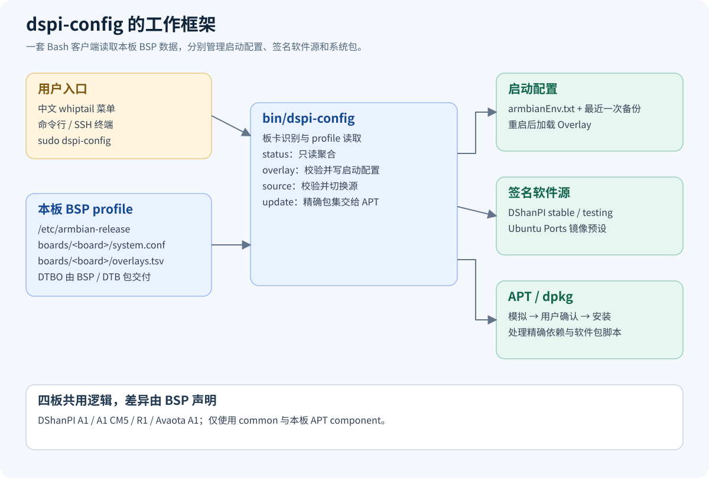
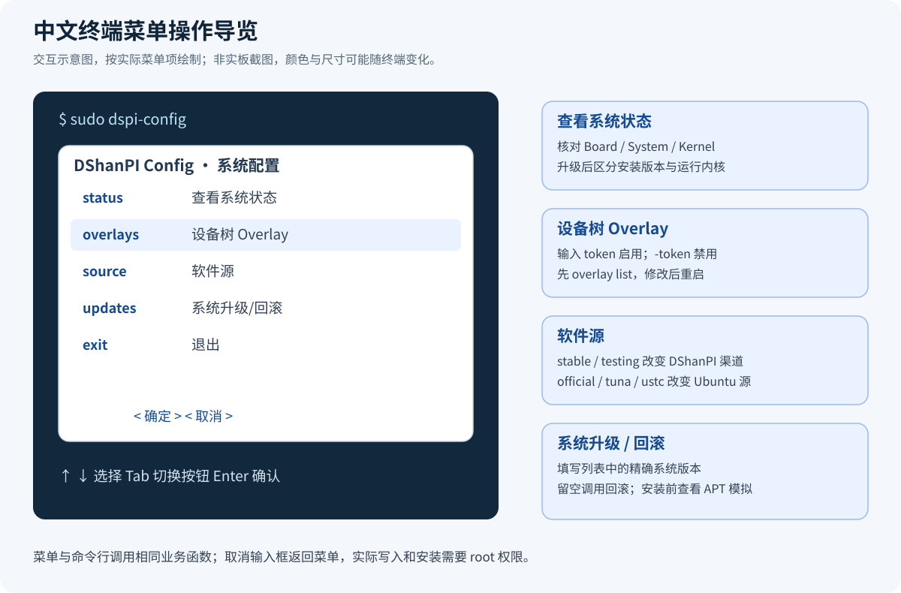
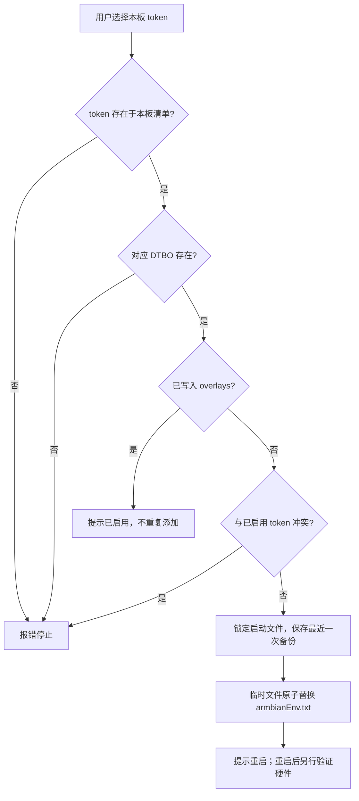
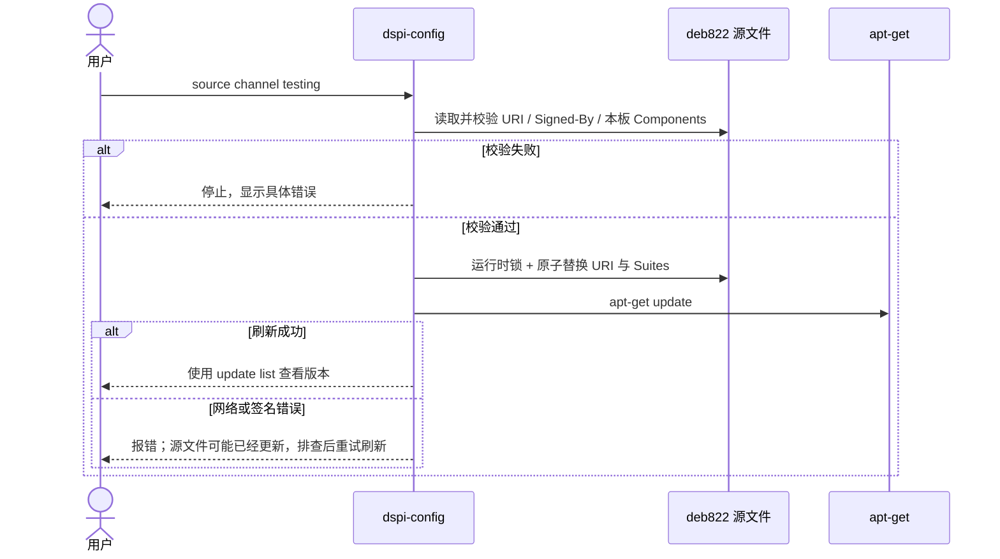
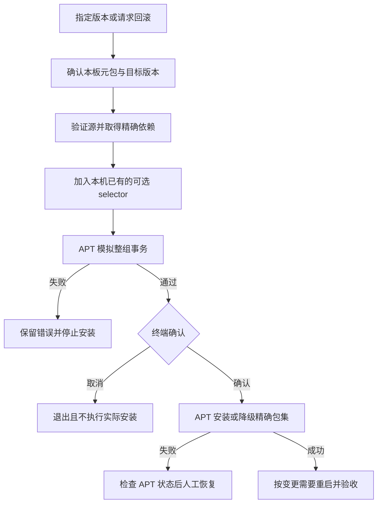
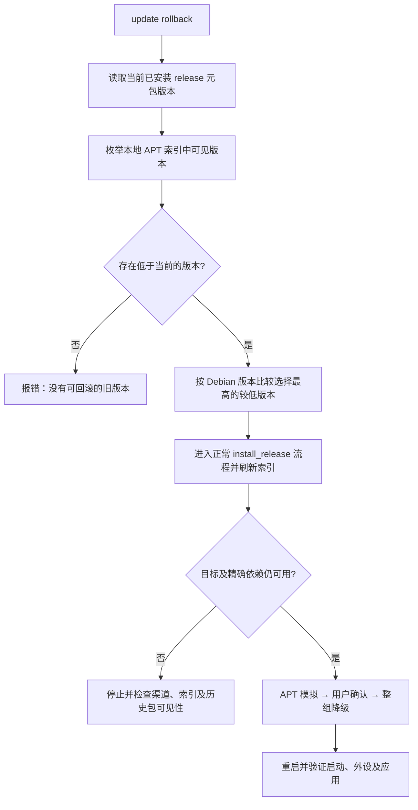

# dspi-config（DShanPI 系统配置工具）

`dspi-config` 是 DShanPI 系统的板端配置工具，提供中文终端菜单和可脚本化命令，用于查看板卡状态、配置设备树 Overlay、切换签名软件源，以及通过 APT 按系统发行版本整组升级和回滚。

用户常说的 **dshanpi-config** 对应本仓库的 **`dspi-config`**；正式仓库名、DEB 包名与命令均为 `dspi-config`，目前没有 `dshanpi-config` 命令别名。

> 本文适用于本仓库实现。DShanPI 产品镜像应预装工具、本板 BSP profile、签名源及发行元包；普通 Ubuntu / Debian 安装一个工具包不会自动补齐这些板级环境。

## 按需求快速选择

| 需求 | 入口 | 操作后的下一步 |
| --- | --- | --- |
| 不熟悉命令，想使用中文菜单 | `sudo dspi-config` | 按菜单选择状态、Overlay、软件源或升级 |
| 看当前系统属于哪块板、哪个版本 | `sudo dspi-config status` | 根据 `Board`、`System`、`Kernel` 核对环境 |
| 想启用某个硬件模式 | `sudo dspi-config overlay list` | 选择本板 token，启用后重启验收 |
| 下载 Ubuntu 软件较慢 | `sudo dspi-config source mirror tuna` | 刷新成功后继续正常 APT 安装 |
| 试用候选系统版本 | `sudo dspi-config source channel testing` | 列出版本，再显式安装目标版本 |
| 更新后需要恢复旧版 | `sudo dspi-config update list` | 选择可见旧版显式安装，或使用 `update rollback` |

首次操作建议先执行状态、软件源与 Overlay 列表三个只读命令，再修改配置。系统发行版本、工具包版本和运行内核版本是三种不同信息。

## 目录

- [整体架构与实现框架](#整体架构与实现框架)
- [主要功能](#主要功能)
- [适用板卡与前提](#适用板卡与前提)
- [快速上手](#快速上手)
- [终端菜单](#终端菜单)
- [典型业务操作流程](#典型业务操作流程)
- [命令速查](#命令速查)
- [查看系统状态](#查看系统状态)
- [配置设备树 Overlay](#配置设备树-overlay)
- [管理软件源](#管理软件源)
- [系统升级与回滚](#系统升级与回滚)
- [脚本调用与权限](#脚本调用与权限)
- [配置文件与 BSP 接口](#配置文件与-bsp-接口)
- [常见问题](#常见问题)
- [进一步阅读](#进一步阅读)

## 整体架构与实现框架



*图 1：菜单和命令行共用同一套业务函数，硬件差异通过本板 BSP profile 表达。*

工具使用 **Bash + whiptail + APT/dpkg**，入口是 `bin/dspi-config`。界面负责接收操作，profile 提供本板数据，APT 负责软件包事务。安装工具本身不会创建另一套系统发行体系。

| 模块 | 代码中的主要函数 | 工作内容与数据 |
| --- | --- | --- |
| 入口与交互 | `usage`、`interactive_menu`、末尾命令分派 | 无参数打开菜单；带参数进入对应命令 |
| 板卡与配置 | `board_name`、`profile_value`、`overlay_directory` | 读取 `BOARD`、system.conf、Overlay 目录 |
| 系统状态 | `show_status` | 聚合启动文件、渠道、已安装元包与 `uname -r` |
| Overlay 管理 | `list_overlays`、`enable_overlay`、`disable_overlay`、`write_env_key` | 校验 token/DTBO/冲突，备份并写入 armbianEnv |
| 软件源管理 | `validate_dshanpi_source`、`set_channel`、`set_mirror`、`replace_deb822_field` | 校验 DShanPI 源，使用锁和原子替换更新字段 |
| 版本安装 | `release_package`、`list_updates`、`install_release` | 识别本板元包，解析精确依赖，模拟并执行 APT |
| 回滚选择 | `rollback_release` | 从本地 APT 索引选择低于当前版本的最高版本 |

外部数据的归属也决定了排查方向：板型与可选 Overlay 检查 BSP；发行版本和依赖检查签名 APT；菜单与参数检查本工具。读取启动配置显示的 Overlay 状态，不等于检测到硬件已正常工作。

## 主要功能

| 功能 | 可以完成的操作 |
| --- | --- |
| 系统状态 | 查看板卡标识、启动配置中的 DTB / Overlay、APT 渠道、已安装系统发行版本与运行内核 |
| Overlay | 列出 BSP 声明的功能，检查 DTBO 和冲突后启用/禁用，备份并更新启动配置 |
| DShanPI 软件源 | 切换 stable / testing，保留官方 keyring 和本板 component，迁移旧源地址 |
| Ubuntu 镜像源 | 切换 Ubuntu Ports 官方、清华 TUNA、中科大 USTC 三个预设 |
| 系统发行安装 | 读取 release 元包，先模拟 APT 事务，再安装整组精确依赖 |
| 系统回滚 | 选择当前 APT 索引中的较低系统版本，显式降级整组精确依赖 |
| 可选硬件配套 | 依据目标发行的精确 `Suggests`，同步本机已安装的硬件 selector |

硬件清单和 DTBO 由 ArmBianOS 的板级 BSP 交付，系统版本与 DEB 由 dshanpi-build 编排发布。配置工具不编译设备树，不生成或发布软件包，也不保管签名私钥。

## 适用板卡与前提

| 产品 | `BOARD` / APT component | 发行元包前缀 |
| --- | --- | --- |
| DShanPI A1 | `dshanpi-a1` | `dshanpi-a1-release-` |
| DShanPI A1 CM5 | `dshanpi-a1-cm5` | `dshanpi-a1-cm5-release-` |
| DShanPI R1 | `dshanpi-r1` | `dshanpi-r1-release-` |
| Avaota A1 | `avaota-a1` | `avaota-a1-release-` |

工具按 `/etc/armbian-release` 的 `BOARD=` 识别板卡，读取 BSP 安装的 profile，不使用其他板卡配置代替。四板共用工具逻辑，具体 Overlay 可选项以本机 `overlay list` 为准。

需要具备：

- Bash、APT、dpkg、coreutils、util-linux；终端菜单另需 `whiptail`，DEB 已声明这些依赖。
- 本板 `/usr/share/dspi-config/boards/<board>/system.conf` 与 `overlays.tsv`。
- 管理系统版本时已安装本板 `release-core` 或 `release-desktop` 元包，以及可信 DShanPI 软件源和 keyring。
- 安装/更新时能够访问软件源；写配置或安装软件包时使用 root / sudo。

**启动配置限制：** 当前 Overlay 写入器操作 `/boot/armbianEnv.txt`。使用 extlinux 的镜像不会被本工具自动改写 extlinux 配置；没有该文件的设备不能直接套用 Overlay 步骤。软件源和发行管理仍按各自环境条件工作。

## 快速上手

在已预装工具的产品镜像上：

```bash
# 查看工具帮助和设备当前状态
sudo dspi-config --help
sudo dspi-config status
sudo dspi-config source show
sudo dspi-config overlay list

# 打开中文终端菜单
sudo dspi-config
```

若当前已配置可信的本板软件源，安装发行允许的配置工具版本可使用：

```bash
sudo apt-get update
sudo apt-get install dspi-config
```

旧系统若存在精确 release 元包约束，应按后文整组升级到包含新版工具的系统发行。APT 拒绝单独升级时，不要删除元包或强制覆盖依赖。

一个完整的 testing 验证流程为：

```bash
sudo dspi-config source channel testing
sudo dspi-config update list
# 将下面版本改为上一步列出的、适用于本板的实际版本
read -r -p '输入列表中的目标系统发行版本：' TARGET_VERSION
if [ -n "$TARGET_VERSION" ]; then
  sudo dspi-config update install "$TARGET_VERSION"
fi
# 涉及内核、BSP、驱动或启动配置时，安排重启
sudo reboot
```

`<version>` 是需要替换的占位符，不应原样复制到 Shell。命令行不支持 `latest`、`upgrade` 等未列出的子命令。

## 终端菜单



*图 2：按实际菜单项绘制的交互示意，非实板截图。左侧是菜单，右侧说明每项的操作结果。*

`sudo dspi-config` 无参数启动 `whiptail` 菜单。通过方向键选择，Tab 切换按钮，Enter 确认；取消当前对话框通常返回上一级。

| 菜单 | 操作 |
| --- | --- |
| 查看系统状态 | 显示板卡、DTB、Overlay、渠道、系统版本与运行内核 |
| 设备树 Overlay | 显示本板清单；输入 token 启用，输入 `-token` 禁用 |
| 软件源 | 选择 DShanPI stable/testing 或 Ubuntu 官方/TUNA/USTC |
| 系统升级/回滚 | 输入列表中的精确版本安装；留空会调用回滚逻辑 |
| 退出 | 关闭菜单 |

Overlay 菜单是 token 输入框，并非硬件自动探测器。升级选择版本后，还会打印 APT 模拟结果并在终端询问是否安装。没有 `whiptail` 时无参数调用只显示用法，命令行接口仍可使用。

## 典型业务操作流程

### 场景一：第一次使用，先确认环境

| 步骤 | 操作 | 看什么 | 下一步 |
| --- | --- | --- | --- |
| 1 | `sudo dspi-config status` | `Board` 是否为本板，`System` 是否已有发行元包 | 板型/profile 不匹配先恢复配套 BSP |
| 2 | `sudo dspi-config source show` | DShanPI 地址、渠道和 Ubuntu 镜像 | 校验错误先处理可信源及 keyring |
| 3 | `sudo dspi-config overlay list` | 本板 token、说明与 DTBO 状态 | 空清单可正常继续软件源/发行操作 |
| 4 | `sudo dspi-config` | 使用图 2 的入口选择目标操作 | 根据变更类型安排重启和验证 |

这四步不要求先升级系统。前 3 个命令用于读取现状，实际操作前仍需满足各章节的环境条件。

### 场景二：为 A1 CM5 切换 PCIe1 模式

前提是本机 `overlay list` 确实列出 `pcie1`，且对应 DTBO 存在。按 BSP 描述确认共享 USB1 的影响后执行：

```bash
sudo dspi-config overlay list
sudo dspi-config overlay enable pcie1
sudo dspi-config overlay list
# 在可以中断当前工作时执行
sudo reboot
```

重启后核对 `sudo dspi-config status`，并按连接设备验证 PCIe 功能。需要恢复时执行 `sudo dspi-config overlay disable pcie1`，再安排一次重启。其他板型以自己的 profile 清单为准。



*图 3：启用 Overlay 的业务流程。写文件失败时保留原始错误，检查启动介质与备份后再处理。*

### 场景三：切换下载镜像或系统渠道

这两个选择作用于不同软件源，可以独立操作：

| 目标 | 命令 | 改变什么 | 操作后确认 |
| --- | --- | --- | --- |
| 更换 Ubuntu 下载镜像 | `sudo dspi-config source mirror tuna` | Ubuntu Ports 的下载地址 | APT 刷新成功，`source show` 显示所选镜像 |
| 试用候选发行 | `sudo dspi-config source channel testing` | DShanPI suite 为 `noble-testing` | `update list` 中出现适用候选版本 |
| 返回正式渠道 | `sudo dspi-config source channel stable` | DShanPI suite 为 `noble` | 核对可见版本；已安装候选不会自动降级 |



*图 4：切换 DShanPI 渠道的顺序。切换 Ubuntu 镜像时使用预设地址修改 ubuntu.sources，不走 DShanPI component 校验。*

### 场景四：安装指定候选，重启后验收

在目标设备上按顺序执行；版本从本机列表选择：

```bash
sudo dspi-config status
sudo dspi-config source channel testing
sudo dspi-config update list
read -r -p '输入列表中的目标系统发行版本：' TARGET_VERSION
if [ -n "$TARGET_VERSION" ]; then
  sudo dspi-config update install "$TARGET_VERSION"
fi
```

安装前查看 APT 模拟中的升级、降级和删除项，在终端确认后完成安装。若实际 APT 再次询问，按其提示处理。完成后根据变更安排重启，重新核对 `status` 并验证受影响外设；软件包安装成功和设备功能验收分别确认。

需要恢复时，先 `sudo apt-get update`、`sudo dspi-config update list`，再使用 `update install` 显式指定可用旧版本。自动选择方式见下文“回滚到较低版本”；改回 stable 本身不会恢复旧包。

## 命令速查

| 命令 | 作用 | 权限与生效时机 |
| --- | --- | --- |
| `dspi-config --help` | 显示用法 | 只读 |
| `dspi-config status` | 查看状态 | 只读，需能读取板级文件 |
| `dspi-config overlay list` | 列出当前板卡 Overlay | 只读 |
| `sudo dspi-config overlay enable <token>` | 启用指定 Overlay | 修改启动配置，重启后生效 |
| `sudo dspi-config overlay disable <token>` | 禁用指定 Overlay | 修改启动配置，重启后生效 |
| `dspi-config source show` | 校验并显示软件源 | 只读 |
| `sudo dspi-config source channel stable` | 使用 `noble` | 修改源并执行 `apt-get update` |
| `sudo dspi-config source channel testing` | 使用 `noble-testing` | 修改源并执行 `apt-get update` |
| `sudo dspi-config source mirror official` | Ubuntu Ports 官方镜像 | 修改源并刷新索引 |
| `sudo dspi-config source mirror tuna` | 清华 TUNA | 修改源并刷新索引 |
| `sudo dspi-config source mirror ustc` | 中科大 USTC | 修改源并刷新索引 |
| `dspi-config update list` | 列出本机发行元包的可用版本 | 读取本地 APT 索引，不自动刷新 |
| `sudo dspi-config update install <version>` | 安装指定发行及精确包集 | 刷新索引、模拟、确认、执行 APT |
| `sudo dspi-config update rollback` | 安装可见的最高较低版本 | 同样经过模拟、确认与 APT |

二进制安装在 `/usr/sbin/dspi-config`。普通用户 PATH 不包含 `/usr/sbin` 时可使用绝对路径或 `sudo dspi-config`。

## 查看系统状态

```bash
sudo dspi-config status
```

| 字段 | 含义 |
| --- | --- |
| `Board` | `/etc/armbian-release` 的板卡标识 |
| `FDT` | `armbianEnv.txt` 中的 `fdtfile`，不是运行中设备树的完整检测结果 |
| `Overlays` | 启动配置已填写的 token，不代表已经重启加载 |
| `APT channel` | DShanPI 源 suite 映射为 stable/testing |
| `System` | 已安装 release 元包版本；桌面元包优先，其次 core |
| `Kernel` | `uname -r` 返回的当前运行内核 |

更新内核但尚未重启时，`System` 与 `Kernel` 分别反映已安装包集和仍在运行的内核，两者可能处于切换过渡阶段。`unknown` 或 `not-installed` 应结合板级配置、元包和启动方式排查。

### 状态输出示例

下面仅展示字段格式，版本和内核用说明文字代替；以设备实际输出为准：

```text
Board:       dshanpi-a1-cm5
FDT:         rockchip/rk3576-100ask-dshanpi-a1-cm5.dtb
Overlays:    none
APT channel: testing
System:      <已安装的系统发行版本>
Kernel:      <当前运行的内核 release>
```

查看工具包自身版本可使用：

```bash
dpkg-query -W -f='${Package} ${Version}\n' dspi-config
```

## 配置设备树 Overlay

Overlay 用于启用 BSP 声明的可选硬件模式，如接口复用。先查看本机支持的 token：

```bash
sudo dspi-config overlay list
```

输出包括 `TOKEN`、`STATE`、`NAME`、`DESCRIPTION`。状态含义：

| 状态 | 含义 |
| --- | --- |
| `enabled` | token 已写入启动配置且对应 DTBO 文件存在 |
| `disabled` | 未写入启动配置，但对应 DTBO 存在 |
| `missing` | 清单声明的 DTBO 不存在，不能据此正常启用 |

例如 **A1 CM5 的 BSP 提供 `pcie1` 时**：

```bash
sudo dspi-config overlay enable pcie1
sudo reboot
# 以后如需恢复：
sudo dspi-config overlay disable pcie1
sudo reboot
```

该模式按 CM5 profile 描述会禁用共享 USB1 主机路径并启用 PCIe1，选择前应结合接线和实际使用需求。不能将这个 token 套用到其他板卡；其他产品可能只有主设备树，清单为空属于正常情况。

启用时工具校验 token 在本板清单中、DTBO 文件存在，并检查该记录声明的冲突 token。重复启用已有 token 不重复添加。工具基于清单校验，不会探测实际硬件接线，也没有通用硬件依赖自动安装器。

写入 `/boot/armbianEnv.txt` 时使用文件锁及同目录临时文件替换，保留其他配置项，并将修改前文件保存为：

```text
/boot/armbianEnv.txt.dspi-config.bak
```

备份在每次实际写入时更新，**仅保留最近一次写入前的状态**。连续修改前如需长期恢复点，应另外保存副本。工具不会自动重启。

若配置错误影响启动，在可访问启动介质的维护环境中先核对备份内容，再恢复：

```bash
sudo cp -a /boot/armbianEnv.txt.dspi-config.bak /boot/armbianEnv.txt
sudo reboot
```

不要用其他板卡的启动配置替换本板文件，也不要把恢复单个启动文件当作整组系统回滚。

## 管理软件源

### DShanPI stable / testing

DShanPI 软件源根地址为 `https://apt.100ask.net`：

| 渠道 | APT suite | 使用方式 |
| --- | --- | --- |
| stable | `noble` | 已完成适用验收的发行，进入正常 APT 更新路径 |
| testing | `noble-testing` | 显式选用的候选，需选择精确系统版本 |

```bash
sudo dspi-config source show
sudo dspi-config source channel testing
sudo dspi-config update list
```

切换渠道仅改变源并刷新索引，**不会安装或降级任何系统包**。从 testing 切回 stable 后若想降级，仍须确认目标版本可见并显式安装。

写入前验证官方域名、官方 `Signed-By` 和 profile 中声明的 `Components`，拒绝 `Trusted: yes`。每块板只使用 `common` 加本板 component，不要添加其他板型 component 解决依赖。

CM5 的 deb822 源配置示例：

```text
Types: deb
URIs: https://apt.100ask.net
Suites: noble
Components: common dshanpi-a1-cm5
Architectures: arm64 all
Signed-By: /usr/share/keyrings/dshanpi-archive-keyring.gpg
```

这是配置结构说明，应由该产品 repository DEB 提供。手工粘贴其他板型示例会导致 component 校验失败。

旧镜像中的 `https://dl.100ask.net/apt` 仍可被识别。选择 stable/testing 或安装指定系统版本时，工具将其迁移到新域名，继续保留签名 keyring 和板型 component。

### Ubuntu Ports 镜像

```bash
sudo dspi-config source mirror official
# 也可以选择：tuna 或 ustc
```

预设地址来自包内 `mirrors.tsv`：

| 标识 | 镜像 | 地址 |
| --- | --- | --- |
| `official` | Ubuntu Ports 官方 | `https://ports.ubuntu.com/ubuntu-ports` |
| `tuna` | 清华 TUNA | `https://mirrors.tuna.tsinghua.edu.cn/ubuntu-ports` |
| `ustc` | 中科大 USTC | `https://mirrors.ustc.edu.cn/ubuntu-ports` |

只修改 `/etc/apt/sources.list.d/ubuntu.sources` 的 `URIs`，保留 suite、component 和签名设置。它是 Ubuntu Ports 预设切换功能，不能用来将 Debian 软件源转换成 Ubuntu 源。

软件源写入锁位于 `/run/dspi-config/`，按源文件完整路径区分，更新使用原子替换。旧版遗留的 `.dspi-config.lock` 文件可能仍被进程持有，不应盲删；包内 APT 配置只忽略这类旧辅助文件的扫描提示。

源文件修改后若网络刷新失败，源配置可能已经更新。查看原始错误、运行 `source show`，网络恢复后重试 `sudo apt-get update`；不会自动切回旧源。

## 系统升级与回滚

### 查询并安装精确版本

```bash
sudo apt-get update
sudo dspi-config update list
read -r -p '输入列表中的目标系统发行版本：' TARGET_VERSION
if [ -n "$TARGET_VERSION" ]; then
  sudo dspi-config update install "$TARGET_VERSION"
fi
```

`update list` 显示元包名、已安装版本和本地索引中可用版本。版本是 **系统 release 元包版本**，不是内核 release，也不是 `dspi-config` 自身的 DEB 版本。

安装逻辑：

1. 验证签名源与本板 components，迁移旧域名并刷新 APT 索引。
2. 识别已安装的本板 desktop 或 core 元包，检查目标版本存在。
3. 读取目标元包的精确 `Depends`，生成完整 `包名=版本` 列表。
4. 读取精确 `Suggests`，仅将本机已安装的可选 selector 加入目标列表。
5. 执行 `apt-get --simulate install --allow-downgrades ...`，展示预计操作。
6. 终端确认后执行实际 APT 安装，结束时提示重启并验证硬件。



*图 5：指定版本安装的完整事务流程，模拟失败或用户取消时不执行实际包安装。*

模拟结果可能包含降级或删除，请核对是否符合所选发行。工具调用 APT 处理依赖和包脚本，不提供文件系统级快照，也不能保证断电后整个事务自动恢复到旧状态。

### 可选硬件如何跟随更新

发行元包用 `Suggests: selector (= 精确版本)` 表达可选硬件配套。已安装该 selector 时，工具同步目标版本，由 selector 精确依赖拉取对应驱动、运行库和固件；未安装时不主动添加。

如果只有手工安装的 runtime 而没有 selector，不能假定它会自动纳入这套同步逻辑。AXCL 8GB / 16GB 等互斥套件须先按组件说明明确选择，不能靠系统升级隐式切换硬件容量。

### 回滚到较低版本

```bash
sudo dspi-config update list
sudo dspi-config update rollback
```

`rollback` 在**调用时本地 APT 索引可见版本中**，选择低于当前已安装版本的最高版本，再走正常安装流程；它不会查询“上一次安装历史”，也不保证返回最初烧录版本。目标选定后安装流程还会刷新索引并再次核对可用性，因此索引陈旧时可能停止。

需要明确恢复到某一版时，优先刷新索引后直接指定：

```bash
sudo apt-get update
sudo dspi-config update list
read -r -p '输入列表中可用的旧系统发行版本：' TARGET_VERSION
if [ -n "$TARGET_VERSION" ]; then
  sudo dspi-config update install "$TARGET_VERSION"
fi
```

回滚会显式传入元包与全部精确依赖，避免仅降低版本标记而留下较新内核/BSP。旧版必须仍在当前渠道索引中且全部依赖可下载；历史 pool 中保留 DEB 不等于撤回的候选仍可被客户端列出。



*图 6：回滚是重新安装一致的旧包集，版本选择来自当前索引，不来自安装历史。图 5 为前文的版本安装流程。*

### stable 与标准 APT

stable 发布采用正常 APT 优先级，可使用标准 APT 更新路径；本工具适合显式安装和回滚整组版本。testing 带 `NotAutomatic`，应通过本工具选择精确版本。切换渠道不会配置无人值守更新或自动重启，也不执行 Ubuntu / Debian 大版本迁移。

## 脚本调用与权限

读取命令无需写入权限；启用/禁用 Overlay、修改源及实际安装必须使用 root。建议通过 SSH 或本机终端交互执行升级。

非交互执行 `update install` 必须显式设置 `DSPI_ASSUME_YES=yes`，否则工具拒绝跳过自身确认。但该变量**只跳过工具的确认**，不会给实际 `apt-get install` 自动添加 `-y`，也不会解决 conffile、包脚本或重启相关交互。需要完全无人值守时，须另行设计和验证 APT 策略，不应把这个变量当成完整自动升级方案。

帮助调用退出码为 0，参数错误通常为 2，业务校验错误通常为 1；外部命令失败还可能保留其退出码。脚本应检查非零结果和原始错误输出。

## 配置文件与 BSP 接口

| 路径 | 来源与用途 |
| --- | --- |
| `/etc/armbian-release` | BSP 板卡身份与 Overlay 目录信息 |
| `/boot/armbianEnv.txt` | 当前 Overlay 写入目标，读取 `fdtfile` / `overlays` |
| `/boot/armbianEnv.txt.dspi-config.bak` | 最近一次启动配置写入前备份 |
| `/usr/share/dspi-config/boards/<board>/overlays.tsv` | BSP 提供的 Overlay 清单 |
| `/usr/share/dspi-config/boards/<board>/system.conf` | BSP 提供的 component 与元包映射 |
| `/etc/apt/sources.list.d/dshanpi.sources` | 本板 DShanPI 签名源 |
| `/etc/apt/sources.list.d/ubuntu.sources` | Ubuntu Ports deb822 源 |
| `/usr/share/keyrings/dshanpi-archive-keyring.gpg` | 官方归档公钥，由 keyring 包提供 |
| `/usr/share/dspi-config/mirrors.tsv` | Ubuntu 镜像预设 |
| `/etc/apt/apt.conf.d/20dspi-config` | 旧锁文件名的 APT 扫描忽略配置 |
| `/run/dspi-config/` | 软件源运行时锁 |
| `/usr/share/doc/dspi-config/README.md` | 随 DEB 安装的本文 |

### overlays.tsv 格式

文件名沿用 `.tsv`，实际以竖线 `|` 分隔五列，注释以 `#` 开头：

```text
token|dtbo-basename|中文名称|说明|冲突token列表
```

- `token` 写入 `armbianEnv.txt` 的 `overlays=`；用户命令只传 token。
- `dtbo-basename` 是不含 `.dtbo` 后缀的实际文件名。
- 冲突 token 用逗号分隔；工具检查本条记录声明的冲突，BSP 作者应维护完整关系。
- 空清单表示目前没有开放可选 Overlay，不影响已具备前提的软件源或发行管理。

DTBO 目录读取 `/etc/armbian-release` 的 `OVERLAY_DIR`，典型为 `/boot/dtb/rockchip/overlay` 或 `/boot/dtb/allwinner/overlay`；未声明时回退到 Rockchip 默认目录。BSP 应提供正确目录，不依赖回退。

### system.conf 格式

CM5 示例：

```text
apt_components=common dshanpi-a1-cm5
release_meta_core=dshanpi-a1-cm5-release-core
release_meta_desktop=dshanpi-a1-cm5-release-desktop
```

该文件仅作为数据读取，不会作为 Shell 脚本执行。其他板型使用自己的标识和元包名；新增板卡在 ArmBianOS BSP 中交付 profile，再由 dshanpi-build 配置发行，无需在客户端硬编码硬件选项。

## 常见问题

| 现象 | 原因与处理 |
| --- | --- |
| `command not found` | 确认包是否安装，以及 PATH 是否包含 `/usr/sbin`；可用 `sudo dspi-config` |
| 无法识别板卡 / profile 不存在 | 核对 `/etc/armbian-release` 与本板 BSP 包，不能借用其他板型 profile |
| `overlay list` 只有表头 | 本板当前清单为空，或 BSP 尚未提供可选项 |
| `未知 overlay` | token 不在本板清单；用 `overlay list` 确认拼写和板型 |
| `DTBO 文件不存在` | 检查配套 DTB/BSP 包及 `OVERLAY_DIR`，不要手工塞入未知来源文件 |
| Overlay 冲突 | 先确认接口复用关系，再禁用冲突项，重启验证 |
| 启用后状态改变但硬件没变化 | 该状态表示启动配置；确认已经重启，再检查对应硬件与驱动 |
| `启动环境文件不存在` | 当前镜像可能采用 extlinux 等路线，Overlay 写入器不适用 |
| 软件源地址 / keyring / component 校验失败 | 检查本板 repository 与官方 keyring 包，按可信包恢复；不使用 `Trusted: yes` |
| `系统未安装 DShanPI 发行版本元包` | 工具不能推断已有系统的整组版本；需由对应发行的可信安装方案补齐元包及依赖 |
| 看不到目标版本 | 刷新索引，确认渠道、板型与该版本是否仍被索引；`update list` 不自动刷新 |
| `没有可回滚的旧版本` | 当前可见索引中没有较低版本，切源本身不会创建回滚点 |
| 非交互执行拒绝确认 | 参考脚本调用说明；优先交互安装并检查模拟结果 |
| APT 索引刷新失败 | 检查网络、DNS、时间和签名错误，保留原始报错，不禁用验签 |
| APT/dpkg 锁被占用 | 等待已有包管理任务结束，不删除正在使用的锁文件 |
| 安装中断或依赖损坏 | 先检查 `dpkg --audit` 和 APT 日志，再评估 `dpkg --configure -a`、`apt-get -f install` 的修复动作 |

配置变更前做好必要备份。启动配置恢复、系统包版本回滚与用户数据恢复分别处理；本工具不会备份应用数据。

### 收集排查信息

遇到问题时，先保存以下只读输出和失败命令的完整错误，方便维护者判断板型、包版本、源配置及启动路线：

```bash
cat /etc/armbian-release
sudo dspi-config status
sudo dspi-config source show
sudo dspi-config overlay list
dpkg-query -W -f='${Package} ${Version} ${db:Status-Status}\n' \
  dspi-config '*-release-core' '*-release-desktop'
dpkg --audit
```

某些元包未安装时，`dpkg-query` 可能同时报告未找到匹配包；这也是排查信息。APT 事务日志通常在 `/var/log/apt/history.log` 与 `/var/log/apt/term.log`，包配置日志在 `/var/log/dpkg.log`。提交问题时说明操作前版本、目标版本、渠道、是否已重启，以及可复现步骤；分享前检查日志中是否有个人或私有环境信息。

## 进一步阅读

- [dshanpi-build 使用文档](https://github.com/dshanpi/dshanpi-build/blob/main/README.md)：构建与发布系统软件包、镜像。
- 开发资料：[开发维护指南](https://github.com/dshanpi/dspi-config/blob/main/docs/development-guide.md)、[开发交付政策](https://github.com/dshanpi/dspi-config/blob/main/DELIVERY_POLICY.md)。

本文 SVG 插图与 README 一起安装；离线查看时图片使用相对路径。Mermaid 流程图需查看器支持对应渲染。
