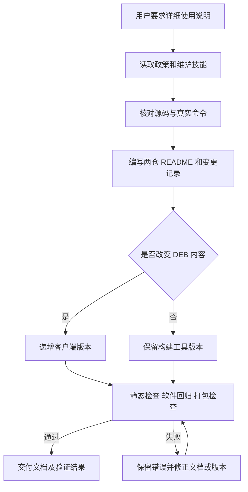

# 完善构建编排与板端配置工具的中文使用说明

## 需求与范围

用户要求为 dshanpi-build 与 dshanpi-config 编写详细丰富的功能、使用 README。
本需求的客户端正式名称为 dspi-config。覆盖 A1、A1 CM5、R1、Avaota A1，分别面向发行维护者
和设备用户，说明真实入口、操作前提、版本关系、配置文件、失败恢复与验证范围。
本次不执行远端发布、板端安装、stable 晋级或历史 lock 改写。

## 业务逻辑

逐项对照三个仓库现有脚本、BSP profile、产品配置与工作流，重写根 README。
构建说明明确 CI 发布 DEB/APT 与本机组装镜像的边界，维护 adapter 的实际支持范围，以及精确包集。
客户端说明明确 Overlay 重启/最近一次备份、渠道切换不安装包、可见索引回滚选择与可选 selector 同步。
补充按任务导航、只读计划预览、交付物核对、状态示例与问题信息收集步骤。
保持现有程序、包配方、板级源码及交付政策不变。
README 属于 DEB 有效负载，VERSION 从 1.0.3-1 递增为 1.0.3-2；不能覆盖历史同身份软件包。
## 流程

## 安全与失败分支

本次只修改文档与客户端版本标识；不调用发布器，不使用生产私钥或远端凭据。
命令示例区分预览、构建、发布及用户需替换的版本变量；不把历史日期称为最新 stable。
文档中的源锁、签名、依赖模拟及实板证据要求均依据源码，不声称事务具备文件系统快照能力。
若源码、链接或命令检查失败，修正对应说明后重新验证；不通过关闭门禁掩盖失败。
工作区已有其他修改保留原样，不暂存或提交用户的其他文件。

## 测试报告

| 类型 | 命令/检查 | 结果 | 证据 |
| --- | --- | --- | --- |
| static | `python3 tools/check-delivery-policy.py --peer ../ArmBianOS --peer ../dshanpi-build` | PASS | 三仓政策一致；仅代表政策接入检查 |
| static | README 本地链接、标题锚点与代码围栏检查（Python `re` / `pathlib`）；对照实际脚本核对命令 | PASS | 两仓相对路径及目录锚点均存在，围栏配对；远端链接未发起网络检查 |
| static | shell `bash -n`、`python3 tools/check-repository-hygiene.py`、`git diff --check` | PASS | 语法、当前 Git 索引及空白检查通过；本次未暂存文件 |
| static | `python3 tools/check-change-record.py` | PASS | 仓库变更记录结构检查通过 |
| software | `bash tests/test.sh` | PASS | 输出 `dspi-config tests passed`；源锁、并发写入和真实 APT 扫描回归通过，APT 安装事务为模拟 |
| build | `(umask 0002; bash packaging/build-deb.sh output)`（在 dspi-config 根目录）；`dpkg-deb -f` 及解包 README 字节比较 | PASS | 本地生成 `dspi-config_1.0.3-2_all.deb`，Package/Version/Architecture 正确，文档与源码逐字节相同；SHA-256 见下文 |
| public | 公开 APT / GitHub Release 验证 | NOT-RUN | 本需求未执行远端发布或网络端点验收 |
| hardware | 启动、外设及整组回滚实板检查 | NOT-RUN | 文档任务未连接实板 |

本地客户端 DEB SHA-256：`ae79530f14824f51e16d769c62806e8b7c96875b0571bf3c31b6af1292d834a1`。
该哈希只标识本次本地构建，不表示已发布或已通过实板安装。

## 未完成项

公共发布、安装和实板验证不在本次文档任务中执行。正式发行新版客户端时，须先固定本次修改后的
完整源码 commit，由 dshanpi-build 为四个受影响产品生成新精确依赖元包并完成常规 testing/stable 门禁。
现有维护 dispatcher 尚无通用 dspi-config adapter，不能将其描述为已经支持的发行能力。

## 交付影响

根 README 会进入 DEB，故客户端版本从 1.0.3-1 提高到 1.0.3-2；本次仅验证本地包，不发布。
程序、依赖和 BSP 契约不变，文档更新本身无需设备重启。旧 release lock 仍固定旧客户端，
不得在正式发行时只替换工具；新客户端对应的四产品新元包及 APT 发布另走新发行。
